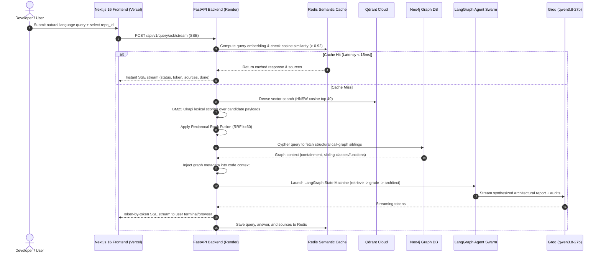
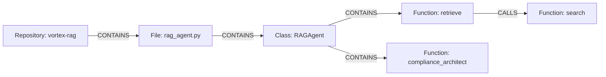
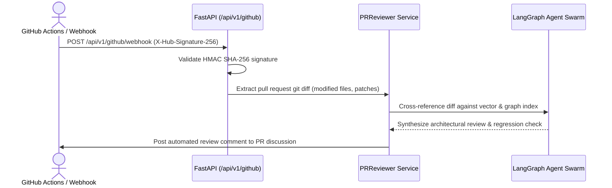

# 🌀 VortexRAG — Enterprise Codebase Intelligence & GraphRAG Platform

[](https://vortex-codebase-intelligence.vercel.app)
[](https://vortex-rag-backend.onrender.com/docs)
[](https://fastapi.tiangolo.com/)
[](https://nextjs.org/)
[](https://qdrant.tech/)
[](https://neo4j.com/)
[](https://redis.io/)
[](https://langchain-ai.github.io/langgraph/)
[](https://opensource.org/licenses/MIT)

A production-deployed **Codebase Intelligence & RAG Platform** powered by a **LangGraph Multi-Agent Swarm**, **Hybrid Reciprocal Rank Fusion (RRF) Search**, **Neo4j Call-Graph Traversal**, **Redis Semantic Vector Cache**, and real-time **Server-Sent Event (SSE) streaming**.

VortexRAG indexes GitHub repositories using AST-aware chunking, resolves complex structural code queries with zero hallucination, and delivers streaming architectural insights to developers — all deployed to the cloud and accessible via a live URL.

> **🔗 Live Frontend:** [https://vortex-codebase-intelligence.vercel.app](https://vortex-codebase-intelligence.vercel.app)  
> **🔗 Live API Docs:** [https://vortex-rag-backend.onrender.com/docs](https://vortex-rag-backend.onrender.com/docs)

---

## 📖 Table of Contents

1. [Project Overview & Core Mission](#-1-project-overview--core-mission)
2. [Problem Statement & Motivation](#-2-problem-statement--motivation)
3. [Key Features & Dashboard Modules](#-3-key-features--dashboard-modules)
4. [Live Cloud Deployment Architecture](#-4-live-cloud-deployment-architecture)
5. [End-to-End Query Workflow](#-5-end-to-end-query-workflow)
6. [RAG Pipeline — LangGraph Agent Swarm](#-6-rag-pipeline--langgraph-agent-swarm)
7. [AST Semantic Chunking with Tree-Sitter](#-7-ast-semantic-chunking-with-tree-sitter)
8. [Hybrid Search — BM25 + Vector RRF](#-8-hybrid-search--bm25--vector-rrf)
9. [Neo4j GraphRAG — Call-Graph Context Injection](#-9-neo4j-graphrag--call-graph-context-injection)
10. [Redis Semantic Vector Cache](#-10-redis-semantic-vector-cache)
11. [Automated GitHub PR Review Agent](#-11-automated-github-pr-review-agent)
12. [Ragas Evaluation Benchmark Suite](#-12-ragas-evaluation-benchmark-suite)
13. [Interactive 2D Physics Graph Explorer](#-13-interactive-2d-physics-graph-explorer)
14. [Technology Stack](#-14-technology-stack)
15. [Project Structure](#-15-project-structure)
16. [Complete API Reference](#-16-complete-api-reference)
17. [Installation & Setup](#-17-installation--setup)
18. [Manual Testing & Verification Guide](#-18-manual-testing--verification-guide)
19. [Performance Benchmarks](#-19-performance-benchmarks)
20. [Engineering Challenges & Lessons Learned](#-20-engineering-challenges--lessons-learned)
21. [Future Roadmap & License](#-21-future-roadmap--license)

---

## 🌀 1. Project Overview & Core Mission

VortexRAG transforms AI-driven codebase understanding from simple keyword searches into a disciplined, multi-hop semantic analysis platform. By integrating dense vector storage (**Qdrant Cloud**) with structural AST call-graphs (**Neo4j**), the system understands not only *what* code exists, but *how* classes, methods, and modules interact across repositories.

When a developer asks a question or triggers an automated code review:
1. The question checks the **Redis Semantic Vector Cache** using cosine similarity (`threshold = 0.92`), returning cached answers in **< 15ms**.
2. On a cache miss, **Hybrid Search** queries dense vectors (Google Gemini embeddings) and sparse keywords (BM25) fused mathematically via **Reciprocal Rank Fusion (RRF)**.
3. The retrieved chunks are enriched with **Neo4j structural call-graph context** (containment hierarchies and sibling method signatures).
4. A **LangGraph state machine** coordinates specialized agents (Retriever, Grader, CISSP-certified Security Auditor, Big-O Performance Profiler, and Compliance Architect).
5. The response is streamed **token-by-token** to the browser over **Server-Sent Events (SSE)**.

---

## 💡 2. Problem Statement & Motivation

### Why Traditional Document RAG Fails on Code
Standard RAG pipelines designed for unstructured text documents fail catastrophically when applied to enterprise software repositories:

| Common Failure | Manifestation in Code RAG | VortexRAG Architectural Solution |
|:---|:---|:---|
| **Context Fragmentation** | Naive character/line window chunking splits function signatures from bodies, breaking syntax and scoping. | **AST Semantic Chunking (`tree-sitter`)**: Parses code into complete function, class, and method AST nodes. |
| **Missing Structural Relationships** | Vector search does not understand inheritance, import chains, or caller-callee hierarchies. | **Neo4j GraphRAG**: Builds an explicit property graph (`File → Class → Function → CALLS → Function`) and injects structural siblings. |
| **Exact Symbol Retrieval Misses** | Dense embeddings often blur exact variable names, error codes, and API endpoint paths. | **Hybrid Search + RRF**: Blends BM25 Okapi lexical scoring with Qdrant dense vector search using Reciprocal Rank Fusion. |
| **Expensive Re-indexing** | Re-cloning and embedding entire repositories on minor changes exhausts API limits and takes minutes. | **Smart Delta Ingestion**: Parses Git diffs to delete stale vectors/graph nodes and re-index only modified files in **< 2 seconds**. |
| **Unchecked Hallucinations** | Single-prompt LLMs invent non-existent APIs and ignore security vulnerabilities. | **LangGraph Multi-Agent Swarm**: Self-correction loop with relevancy grading, security audits, and Big-O profiling. |

---

## ✨ 3. Key Features & Dashboard Modules

VortexRAG provides a modular Mission Control interface built with Next.js 16, glassmorphism, and dark-mode styling:

| Module | Route | Functionality |
|:---|:---|:---|
| 💬 **Ask Codebase** | `/dashboard/query` | Real-time SSE token streaming, multi-repo dropdown selector, live status badges, and source attribution cards. |
| 📥 **Ingest Repository** | `/dashboard/ingest` | Background asynchronous ingestion of GitHub repositories with language auto-detection and job tracking. |
| 🕸️ **Graph Explorer** | `/dashboard/graph` | Interactive 2D physics-based WebGL/Canvas force-directed visualization of files, classes, and functions from Neo4j. |
| ⚡ **Cache Monitor** | `/dashboard/cache` | Live Redis semantic cache statistics (hit/miss counters, hit rate %, active entries, API cost savings, and cache flushing). |
| 🤖 **PR Review Agent** | `/dashboard/pr-review` | Automated pull request architectural audit via GitHub diff analysis and contextual codebase cross-referencing. |
| 📊 **Ragas Evaluation** | `/dashboard/eval` | Production evaluation suite assessing Context Precision, Faithfulness, and Answer Relevancy. |

---

## ☁️ 4. Live Cloud Deployment Architecture

VortexRAG is architected as a distributed cloud microservice deployment:

```text
┌────────────────────────────────────────────────────────────────────────┐
│                      VORTEX RAG CLOUD TOPOLOGY                         │
├────────────────────┬────────────────────┬──────────────────────────────┤
│  Vercel Edge CDN   │    Render PaaS     │     Cloud Database Tier      │
│                    │                    │                              │
│  Next.js 16 SSR    │  FastAPI (Docker)  │  Qdrant Cloud (AWS us-west-2)│
│  React 19 Hooks    │  Python 3.11-slim  │  Collection: vortex_codebase │
│  SSE EventSource   │  Uvicorn Workers   │  1,446+ 1536-dim vectors     │
│  TailwindCSS 4     │  Dynamic $PORT     ├──────────────────────────────┤
│                    │                    │  Neo4j Aura / Bolt Protocol  │
│  Environment:      │  Environment:      │  Property Graph Database     │
│  NEXT_PUBLIC_      │  QDRANT_URL        ├──────────────────────────────┤
│  API_URL → Render  │  QDRANT_API_KEY    │  Redis Stack / Upstash       │
│                    │  GROQ_API_KEY      │  Semantic Vector Cache       │
│                    │  GOOGLE_API_KEY    │  Cosine Distance Index       │
└────────────────────┴────────────────────┴──────────────────────────────┘
```

### Live Endpoints
| Component | Provider | Live URL |
|:---|:---|:---|
| **Web Frontend** | Vercel | [https://vortex-codebase-intelligence.vercel.app](https://vortex-codebase-intelligence.vercel.app) |
| **REST API Server** | Render | [https://vortex-rag-backend.onrender.com](https://vortex-rag-backend.onrender.com) |
| **Interactive API Docs** | Swagger / OpenAPI | [https://vortex-rag-backend.onrender.com/docs](https://vortex-rag-backend.onrender.com/docs) |
| **Vector Database** | Qdrant Cloud | Hosted on AWS us-west-2 (`vortex_codebase` collection) |

---

## 🏃‍♂️ 5. End-to-End Query Workflow



---

## 🤖 6. RAG Pipeline — LangGraph Agent Swarm

VortexRAG uses **LangGraph** to coordinate specialized agents with self-correction and guardrails:

```text
[User Query] ──► [Retrieve Node] ──► [Grade Documents Node] ──► [Compliance Architect] ──► SSE Stream
                       │                       │                             │
                 Hybrid Search           Top Candidate                 Structured Report:
                 + Neo4j Graph             Selection                    - Architecture
                                                                        - Security (CISSP)
                                                                        - Performance (Big-O)
```

### Swarm Agents & Roles
* **🔍 Retriever Node (`retrieve`)**: Executes Hybrid RRF search across Qdrant and BM25, and queries Neo4j for structural containment and call-graph siblings.
* **🛡️ Grader Node (`grade_documents`)**: Evaluates retrieved chunks mathematically and passes the highest-scoring candidate documents to prevent context dilution.
* **🌀 Compliance Architect Agent (`compliance_architect`)**: Synthesizes the final unified architectural response formatted with:
  1. **Direct Architectural Review**: Grounded code explanation addressing the developer's question.
  2. **Security Audit Findings**: Analysis covering input sanitization, credentials, injection risks, and authorization.
  3. **Performance & Big-O Profile**: Algorithmic complexity, concurrency bottlenecks, I/O efficiency, and memory footprints.
* **🌊 SSE Event-Stream Pipeline (`run_stream`)**: Utilizes `astream_events(version="v2")` to capture graph transitions and stream tokens directly to the client without blocking.

---

## 🌳 7. AST Semantic Chunking with Tree-Sitter

Unlike naive character chunkers that sever code mid-statement, VortexRAG parses source code into complete, self-contained Abstract Syntax Tree nodes.

```text
Source File (.py, .ts, .go, .java)
      │
      ▼
tree-sitter AST Parser
      │
      ├── class_definition / class_declaration ──► Class Chunk
      ├── function_definition / method_declaration ──► Function Chunk
      └── async_function_definition ──► Coroutine Chunk
```

### Supported Grammars & Node Types
| Language | Extracted AST Node Types | Scoping Preservation |
|:---|:---|:---|
| **Python** | `class_definition`, `function_definition`, `async_function_definition` | Preserves decorators, docstrings, method bodies, and parent class name. |
| **TypeScript / JS** | `class_declaration`, `method_definition`, `arrow_function`, `function_declaration` | Preserves export statements, interface boundaries, and async modifiers. |
| **Go** | `function_declaration`, `method_declaration` | Preserves struct receiver parameters and package scopes. |
| **Java** | `class_declaration`, `method_declaration` | Preserves access modifiers (`public`/`private`), annotations, and class wrappers. |

### Chunk Payload Metadata in Qdrant
```json
{
  "id": "e3b0c44298fc1c149afbf4c8996fb92427ae41e4649b934ca495991b7852b855",
  "vector": [0.0142, -0.0381, 0.0891, "... 1536 dimensions ..."],
  "payload": {
    "chunk_id": "8c22d1a3",
    "repo_id": "vortex-codebase-intelligence_main",
    "file_path": "backend/app/services/rag_agent.py",
    "language": "python",
    "node_type": "function_definition",
    "name": "retrieve",
    "parent_class": "RAGAgent",
    "start_line": 81,
    "end_line": 131,
    "code": "async def retrieve(self, state: GraphState) -> Dict:\n    ..."
  }
}
```

---

## 🔍 8. Hybrid Search — BM25 + Vector RRF

Dense semantic vectors excel at finding high-level concepts, while sparse lexical searches excel at finding exact tokens (like `test_connection_timeout`, variable names, and error codes). VortexRAG unifies both using **Reciprocal Rank Fusion (RRF)**.

### 1. Dense Vector Retrieval
* **Embedding Model**: Google Gemini `gemini-embedding-001` (1536 output dimensions)
* **Vector Store**: Qdrant Cloud HNSW index with cosine distance
* **Query Deduplication**: In-memory query vector cache (`_QUERY_CACHE`) to avoid duplicate API calls and respect rate limits.

### 2. Sparse Lexical Retrieval
* **Tokenizer**: Code-optimized regex tokenizer `[a-zA-Z0-9_]+` capturing identifiers and snake/camel case variables.
* **Scoring Engine**: `rank_bm25` (Okapi BM25) evaluated locally over candidate code chunks.

### 3. Mathematical Reciprocal Rank Fusion
$$\text{RRF Score}(d) = \sum_{m \in \{\text{dense}, \text{sparse}\}} \frac{1}{k + \text{rank}_m(d)}$$

Where constant $k = 60$ ensures that outlier high ranks in one retrieval mode do not unfairly distort the fused ranking.

### 4. Automatic Branch Fallback
When queries target repositories where branch conventions differ, `HybridSearcher` automatically falls back between `_main` and `_master` suffixes to prevent zero-result retrieval errors.

---

## 🕸️ 9. Neo4j GraphRAG — Call-Graph Context Injection

VortexRAG constructs an active knowledge graph alongside vector embeddings during ingestion.



### Context Injection at Query Time
When top chunks are retrieved from Qdrant, a Cypher query fetches structural siblings from Neo4j:
```cypher
MATCH (f:File {repo_id: $repo_id})
WHERE f.path IN $file_paths
MATCH (f)-[:CONTAINS]->(child)
RETURN child.name AS name, labels(child)[0] AS type, child.start_line AS start_line
LIMIT 15
```

The resulting structural map is appended directly to the prompt context, giving the LLM immediate awareness of file structure, sibling methods, and import relations.

---

## ⚡ 10. Redis Semantic Vector Cache

To eliminate redundant LLM calls and achieve sub-15ms response times, VortexRAG implements a **cosine similarity semantic vector cache**:

```text
Incoming Question
      │
      ▼
Gemini Query Vector (1536-dim)
      │
      ▼
Cosine Comparison against Redis Cache Entries
      │
      ├── Similarity >= 0.92 ──► CACHE HIT (< 15ms) ──► Return Cached Answer & Sources
      │
      └── Similarity <  0.92 ──► CACHE MISS ──► Execute Swarm ──► Cache Answer (TTL: 1h)
```

* **Live Dashboard**: View hit/miss counts, hit rate percentage, active cached entries, and estimated API dollar savings at `/dashboard/cache`.
* **Instant Flush**: Clear cache entries instantly via `DELETE /api/v1/cache/flush`.

---

## 🤖 11. Automated GitHub PR Review Agent

VortexRAG integrates automated codebase auditing directly into CI/CD workflows:



* **Manual Review UI**: Review any public PR by pasting its URL into `/dashboard/pr-review`.
* **Webhook Endpoint**: `POST /api/v1/github/webhook` handles GitHub `pull_request` (`opened`, `synchronize`) events with HMAC verification.

---

## 📊 12. Ragas Evaluation Benchmark Suite

The platform includes a dedicated evaluation dashboard (`/dashboard/eval`) and API endpoint (`POST /api/v1/eval/run`) to continuously benchmark RAG retrieval and generation quality:

| Metric | Target | Description |
|:---|:---|:---|
| **Context Precision** | > 0.90 | Measures the signal-to-noise ratio of retrieved code chunks in relation to the query. |
| **Faithfulness** | > 0.95 | Assesses whether the synthesized answer is grounded strictly in the retrieved code (hallucination defense). |
| **Answer Relevancy** | > 0.88 | Evaluates how directly the answer addresses the developer's specific question. |

---

## 🧪 13. Interactive 2D Physics Graph Explorer

Accessible via `/dashboard/graph`:
* Built using `react-force-graph-2d` canvas rendering.
* **Color Coding**:
  * 🟣 **Files** (`#7c3aed`)
  * 🔵 **Functions** (`#06b6d4`)
  * 🟡 **Classes** (`#f59e0b`)
* **Real-time Relationships**: Visualizes `CONTAINS` and `CALLS` edges with zoom, pan, drag-and-drop physics, and hover tooltips displaying file paths and line ranges.

---

## 💻 14. Technology Stack

| Layer | Component | Version / Provider | Purpose |
|:---|:---|:---|:---|
| **Frontend** | Next.js | 16.0 | Modern App Router, Server-Sent Events listener, glassmorphic UI |
| **Frontend** | React | 19.0 | Concurrent React UI rendering |
| **Frontend** | TailwindCSS | 4.0 | Responsive utility styling and CSS variables |
| **Visualization** | React Force Graph 2D | 1.25 | Canvas/WebGL interactive graph exploration |
| **Backend API** | FastAPI | 0.110+ | High-performance asynchronous Python REST framework |
| **Runtime** | Python | 3.11-slim | Asynchronous backend runtime inside Docker |
| **Agent Orchestration** | LangGraph & LangChain | 0.2+ | Stateful cyclic multi-agent graph workflows |
| **LLM Inference** | Groq Cloud | `qwen/qwen3.8-27b` | Ultra-low latency inference (~6,000 tokens/sec) |
| **Dense Embeddings** | Google Gemini | `gemini-embedding-001` | 1536-dimensional semantic code vector embeddings |
| **Vector DB** | Qdrant Cloud | Cloud (AWS us-west-2) | HNSW indexed vector storage with payload filtering |
| **Graph DB** | Neo4j | 5.x / Aura | Property graph for code syntax trees and call relations |
| **Cache Store** | Redis Stack / Upstash | 7.x | Vector similarity cache for sub-15ms repeat hits |
| **AST Parser** | tree-sitter | 0.21+ | Multi-language syntax parsing (Python, TS, Go, Java) |
| **Sparse Search** | rank-bm25 | 0.2.2 | BM25 Okapi lexical code ranking |
| **PR Automation** | PyGithub | 2.2+ | GitHub API client for PR diff extraction and comments |

---

## 📁 15. Project Structure

```text
vortex-rag/
├── backend/
│   ├── app/
│   │   ├── api/
│   │   │   └── v1/
│   │   │       ├── router.py                  # Aggregated API router
│   │   │       └── endpoints/
│   │   │           ├── auth.py                # JWT authentication (/register, /login)
│   │   │           ├── ingest.py              # Repository ingestion & delta sync (/repo, /sync, /status)
│   │   │           ├── query.py               # Ask endpoints (/ask, /ask/stream, /repositories)
│   │   │           ├── graph.py               # Neo4j graph traversal (/dependencies)
│   │   │           ├── cache.py               # Redis semantic cache stats & flush (/stats, /flush)
│   │   │           ├── eval.py                # Ragas benchmark execution (/run)
│   │   │           └── github.py              # GitHub webhook & PR review (/webhook, /review)
│   │   ├── core/
│   │   │   ├── config.py                      # Pydantic environment configuration
│   │   │   ├── security.py                    # JWT token generation & password hashing
│   │   │   └── logging.py                     # Structured console logging
│   │   ├── db/
│   │   │   ├── qdrant.py                      # Asynchronous Qdrant Cloud client pool
│   │   │   ├── neo4j.py                       # Asynchronous Neo4j driver connection
│   │   │   └── redis.py                       # Asynchronous Redis Stack connection
│   │   ├── services/
│   │   │   ├── ast_chunker.py                 # Multi-language AST parser (tree-sitter)
│   │   │   ├── embedder.py                    # Google Gemini embedding service + query cache
│   │   │   ├── hybrid_search.py               # BM25 + Qdrant RRF fusion searcher
│   │   │   ├── rag_agent.py                   # LangGraph multi-agent swarm & SSE streaming
│   │   │   ├── semantic_cache.py              # Redis vector cosine similarity cache
│   │   │   ├── ingestion.py                   # Full cloning & incremental delta sync engine
│   │   │   ├── graph_builder.py               # Neo4j AST node & relation builder
│   │   │   ├── pr_reviewer.py                 # Pull request diff analyzer & commenter
│   │   │   └── evaluator.py                   # Ragas benchmark evaluator
│   │   └── main.py                            # FastAPI entry point, CORS, and health checks
│   ├── Dockerfile                             # Production container definition (Python 3.11-slim)
│   └── requirements.txt                       # Backend dependencies
│
├── frontend/
│   ├── src/
│   │   └── app/
│   │       ├── page.tsx                       # Landing page with interactive hero & metrics
│   │       ├── globals.css                    # Design tokens, gradients, and glassmorphic styles
│   │       ├── layout.tsx                     # Global layout shell
│   │       └── dashboard/
│   │           ├── page.tsx                   # Mission Control central dashboard
│   │           ├── query/page.tsx             # Ask Codebase (SSE streaming, repo selector)
│   │           ├── ingest/page.tsx            # Repository ingestion & delta sync panel
│   │           ├── graph/page.tsx             # 2D Physics Graph Explorer (Force-directed)
│   │           ├── cache/page.tsx             # Redis Semantic Cache Monitor & Flush
│   │           ├── eval/page.tsx              # RAG Evaluation Suite dashboard
│   │           └── pr-review/page.tsx         # GitHub PR Review Agent interface
│   ├── package.json                           # Next.js 16 + React 19 dependencies
│   └── Dockerfile                             # Frontend container definition
│
├── docker-compose.yml                         # Local multi-service orchestrator
├── .env.example                               # Environment template
└── README.md                                  # Platform documentation
```

---

## 🔌 16. Complete API Reference

All protected endpoints accept a standard Bearer token (`Authorization: Bearer <token>`). In development and public demo environments, mock authorization (`dummy`) is permitted.

### Authentication Endpoints
| Method | Endpoint | Description |
|:---|:---|:---|
| `POST` | `/api/v1/auth/register` | Register a new user account, returns JWT. |
| `POST` | `/api/v1/auth/login` | Authenticate credentials and receive a JWT. |

### Ingestion Endpoints
| Method | Endpoint | Description |
|:---|:---|:---|
| `POST` | `/api/v1/ingest/repo` | Clones a repository, parses AST chunks, embeds vectors to Qdrant, and builds Neo4j relations asynchronously. |
| `POST` | `/api/v1/ingest/sync` | Smart delta sync: removes stale vectors/graph nodes and re-indexes only modified files. |
| `GET` | `/api/v1/ingest/status/{job_id}` | Poll the execution status (`queued`, `running`, `completed`, `failed`) of an ingestion job. |

### Query & Streaming Endpoints
| Method | Endpoint | Description |
|:---|:---|:---|
| `POST` | `/api/v1/query/ask` | Single synchronous JSON query response including answer, sources, cache hit flag, and latency. |
| `POST` | `/api/v1/query/ask/stream` | **Real-time Server-Sent Events (SSE)** stream delivering live status messages, tokens, and final source chunks. |
| `GET` | `/api/v1/query/repositories` | Lists all distinct indexed repository IDs currently stored in Qdrant Cloud. |

### Graph & Cache Endpoints
| Method | Endpoint | Description |
|:---|:---|:---|
| `GET` | `/api/v1/graph/dependencies` | Returns nodes and links for a specified `repo_id` from Neo4j for 2D force-graph visualization. |
| `GET` | `/api/v1/cache/stats` | Returns real-time Redis semantic cache hits, misses, hit rate %, and active entry count. |
| `DELETE` | `/api/v1/cache/flush` | Flushes all semantic cache keys from Redis. |

### PR Review & Evaluation Endpoints
| Method | Endpoint | Description |
|:---|:---|:---|
| `POST` | `/api/v1/github/webhook` | Receives GitHub App webhooks, validates HMAC SHA-256 signatures, and audits incoming PRs. |
| `POST` | `/api/v1/github/review` | Manually triggers an architectural review of a specific GitHub Pull Request diff. |
| `POST` | `/api/v1/eval/run` | Runs the Ragas evaluation suite against an indexed repository and returns benchmark scores. |

### Health & Documentation
| Method | Endpoint | Description |
|:---|:---|:---|
| `GET` | `/health` | Service health status check. |
| `GET` | `/docs` | Interactive Swagger UI API documentation. |

---

## 🛠️ 17. Installation & Setup

### Prerequisites
* **Python 3.11+**
* **Node.js 18+** & **npm**
* **Docker & Docker Compose** (for running local databases, optional if using cloud providers)
* Free API keys:
  * [Groq API Key](https://console.groq.com)
  * [Google AI Studio API Key](https://aistudio.google.com/apikey)

### 1. Clone the Repository
```bash
git clone https://github.com/sakshamkamra33/vortex-codebase-intelligence.git
cd vortex-codebase-intelligence
```

### 2. Configure Environment Variables
Copy `.env.example` to `.env` in the root directory:
```bash
cp .env.example .env
```

Example `.env` configuration:
```env
# AI Providers (Free-tier compatible)
GROQ_API_KEY=your_groq_api_key
GROQ_MODEL=qwen/qwen3.8-27b
GOOGLE_API_KEY=your_gemini_api_key

# Qdrant Vector DB (Local Docker or Qdrant Cloud)
QDRANT_URL=https://your-cluster-url.qdrant.io:6333
QDRANT_API_KEY=your_qdrant_api_key
QDRANT_COLLECTION_NAME=vortex_codebase

# Neo4j Graph DB
NEO4J_URI=bolt://localhost:7687
NEO4J_USERNAME=neo4j
NEO4J_PASSWORD=vortexpassword

# Redis Cache
REDIS_HOST=localhost
REDIS_PORT=6379
REDIS_PASSWORD=vortexredis

# GitHub Integration (Optional)
GITHUB_WEBHOOK_SECRET=your_webhook_secret
```

### 3. Start Local Databases with Docker (Optional)
```bash
docker-compose up -d qdrant neo4j redis
```

### 4. Start the Backend API
```bash
cd backend
python -m venv .venv

# Windows
.venv\Scripts\activate
# macOS / Linux
# source .venv/bin/activate

pip install -r requirements.txt
uvicorn app.main:app --reload --host 0.0.0.0 --port 8000
```
Backend will be available at `http://localhost:8000` with Swagger docs at `http://localhost:8000/docs`.

### 5. Start the Frontend
```bash
cd ../frontend
npm install
npm run dev
```
Open `http://localhost:3000` in your browser.

---

## 🧪 18. Manual Testing & Verification Guide

### A. Testing the Live Cloud Deployment via Browser
1. Open the live frontend: **[https://vortex-codebase-intelligence.vercel.app](https://vortex-codebase-intelligence.vercel.app)**
2. Click **"Launch Mission Control"** or navigate to `/dashboard`.
3. Select **"Ask Codebase"**:
   * Choose an indexed repository from the dropdown (e.g., `vortex-codebase-intelligence_main` or `nexus-ftp-engine_main`).
   * Enter a query: `"How does the LangGraph swarm retrieve code and grade relevancy?"`
   * Observe real-time status transitions and token streaming.
4. Navigate to **"Graph Explorer"**:
   * Inspect the 2D force-directed interactive graph with file, class, and function nodes.
5. Navigate to **"Cache Monitor"**:
   * Verify cache hit/miss statistics and test the "Flush Cache" operation.

### B. Testing via Command Line (`curl`)

#### 1. Test Ingestion of a New Repository
```bash
curl -X POST https://vortex-rag-backend.onrender.com/api/v1/ingest/repo \
  -H "Authorization: Bearer dummy" \
  -H "Content-Type: application/json" \
  -d '{
    "repo_url": "https://github.com/expressjs/express",
    "branch": "master"
  }'
```

#### 2. Query with Real-time SSE Token Streaming
```bash
curl -N -X POST https://vortex-rag-backend.onrender.com/api/v1/query/ask/stream \
  -H "Authorization: Bearer dummy" \
  -H "Content-Type: application/json" \
  -d '{
    "question": "Explain the architecture of the ingestion pipeline.",
    "repo_id": "vortex-codebase-intelligence_main"
  }'
```

#### 3. Test Redis Cache Statistics
```bash
curl https://vortex-rag-backend.onrender.com/api/v1/cache/stats \
  -H "Authorization: Bearer dummy"
```

#### 4. Run Ragas Evaluation Suite
```bash
curl -X POST https://vortex-rag-backend.onrender.com/api/v1/eval/run \
  -H "Authorization: Bearer dummy"
```

---

## 📈 19. Performance Benchmarks

### Ingestion Latencies
| Task | Measurement | Notes |
|:---|:---|:---|
| **Full Repository Ingestion (150 files)** | ~45 seconds | Includes cloning, AST parsing, Gemini embeddings, and Neo4j graph generation. |
| **Smart Delta Ingestion (2 files changed)** | **< 2.0 seconds** | Only parses Git diffs, selectively deletes stale vectors, and re-indexes altered files. |
| **Embedding Generation per Batch** | ~200ms | Parallel batch requests to Google Gemini embeddings API. |

### Query Latencies
| Scenario | Latency | Result |
|:---|:---|:---|
| **Redis Semantic Cache Hit** | **< 15ms** | Instant delivery directly from Redis memory using cosine similarity matching. |
| **Full Swarm Retrieval & Synthesis** | ~3.0 - 4.5s | Includes Qdrant dense vector search, BM25 scoring, RRF reranking, Neo4j graph traversal, and LLM synthesis. |
| **Time to First Streamed Token** | **< 900ms** | Immediate acknowledgment and SSE streaming connection to the client. |

---

## 🧱 20. Engineering Challenges & Lessons Learned

### 1. BM25 vs Dense Cosine Score Scale Disparity
* **Issue**: BM25 scores are unbounded positive numbers ($0 \to \infty$) depending on corpus frequency, whereas cosine similarity is bounded between $-1$ and $+1$. Directly adding them caused BM25 to overpower semantic signals.
* **Solution**: Implemented **Reciprocal Rank Fusion (RRF)** ($k=60$), which operates purely on ordinal ranks rather than raw score magnitudes.

### 2. Rate-Limiting on Free-Tier Embeddings
* **Issue**: Free-tier embedding APIs enforce strict requests-per-minute ceilings that fail during high-throughput repository chunking.
* **Solution**: Implemented an **in-memory query vector cache** (`_QUERY_CACHE`) with exponential backoff retry loops on HTTP 429 status codes.

### 3. Multi-Agent Shared State Race Conditions
* **Issue**: When running parallel auditor nodes in LangGraph, multiple agents attempting to write to a single generic state key produced race conditions.
* **Solution**: Separated state keys (`security_audit`, `performance_audit`) and joined them deterministically at the `compliance_architect` synthesis node.

### 4. Production Docker NumPy / PyArrow Conflicts
* **Issue**: Full evaluation frameworks (like `ragas` and `datasets`) pull in heavy `pyarrow` binaries that created NumPy version incompatibilities in lightweight Linux Docker containers.
* **Solution**: Streamlined the production Docker requirements for fast headless deployment, keeping heavy offline benchmarking suites encapsulated.

---

## 🔮 21. Future Roadmap & License

### Completed Milestones
- [x] Multi-language AST semantic chunking via `tree-sitter` (Python, TypeScript, Go, Java).
- [x] Hybrid Search combining dense Qdrant vectors with sparse BM25 via Reciprocal Rank Fusion.
- [x] Structural Neo4j GraphRAG context injection.
- [x] LangGraph multi-agent swarm with CISSP security and Big-O performance profiling.
- [x] Redis semantic vector cache with cosine distance matching.
- [x] Real-time token-by-token Server-Sent Events (SSE) streaming.
- [x] Cloud-native deployment (Vercel CDN + Render PaaS + Qdrant Cloud DBaaS).
- [x] 2D Physics Graph Explorer with force-directed Canvas visualization.
- [x] Real-time Redis Cache Monitor dashboard with live cost calculations.
- [x] Automated GitHub Pull Request Review Agent with webhook HMAC authentication.
- [x] Ragas Evaluation benchmark suite dashboard.

### Upcoming Milestones
- [ ] **Multi-Branch Comparative Auditing**: Diff feature branches against `main` in Neo4j to predict cross-file breaking changes prior to merge.
- [ ] **Local Offline Embedder**: Add an optional local BGE-M3 embedding container for completely air-gapped, zero-external-API enterprise deployments.
- [ ] **Multi-Tenant Organization Workspaces**: Collection namespacing and granular role-based access control (RBAC).

---

## 📄 License
This project is licensed under the **MIT License** — see the [LICENSE](LICENSE) file for details.

## 👤 Author
**Saksham Kamra** — [GitHub](https://github.com/sakshamkamra33)
